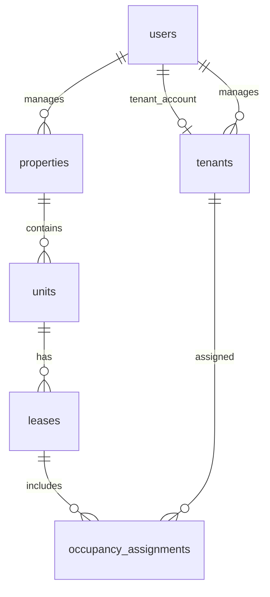

# Database overview

Migrations in this folder define the schema. Local connection settings are in the ignored backend `.env`; the template is `.env.example`. The development database is `propertypro_development` on XAMPP MySQL/MariaDB. Automated tests use in-memory SQLite.

## Implemented tables

| Table | Purpose and relationships |
| --- | --- |
| `users` | Identity, hashed password, role (`admin`, `manager`, `tenant`) |
| `properties` | Name/address; `manager_id` references the owning user |
| `units` | Property, unit code, occupant capacity; property/code unique |
| `tenants` | Tenant account and phone; unique `user_id`, owning `manager_id` |
| `leases` | Unit, inclusive start/end dates, monthly rent in centavos, individual/shared arrangement |
| `occupancy_assignments` | Lease, Tenant and inclusive dates; dated membership for future eligibility rules |
| `rent_cycles` | Unique lease/due-date cycle; source current/advance centavos and occupant snapshot |
| `rent_bills` | Unique cycle/Tenant allocation; separate current/advance centavos and payment status |
| `sessions`, `cache`, `cache_locks` | Laravel session/cache persistence |
| `jobs`, `job_batches`, `failed_jobs` | Laravel background-job infrastructure; domain jobs not yet implemented |
| `password_reset_tokens` | Scaffold schema only; password-reset feature not enabled |
| `migrations` | Tracks applied schema versions |

API transactions enforce ownership, lease overlap, Tenant overlap, within-lease dates, and peak occupancy limits. These cross-row rules are not enforced by foreign keys alone. Concurrent allocation changes lock the Tenant/unit rows. Source code currently lives in `FoundationController`; split validation/policies/domain services as additional modules mature.

## Planned schema work

The following entities describe required future data, not tables already created. Final columns and indexes will be implemented with their respective workflows.

| Future area | Required records and controls |
| --- | --- |
| Utility mapping | Providers/accounts/references, property or unit mapping, dated shared groups and eligibility |
| Source documents/OCR | Private document reference, intake identity, billing period, extracted fields, processing state |
| Validation/exceptions | Reasons, Manager corrections, original/revised values, revalidation history |
| Billing | Rent cycles, utility source charges, itemized Tenant charges, eligibility snapshots, exact centavo totals, uniqueness to prevent duplicates |
| Payments | Reported and confirmed amounts/states, Manager verification/rejection history, no independent system verification |
| Advance rent | Confirmed one-month advance, final-cycle credit application recorded once, preserved original payment/receipt |
| Receipts | Authorized unique receipt tied to confirmed payment; repeat confirmation returns the existing receipt |
| Web Push | Tenant browser subscriptions, billing-alert/reminder jobs, attempts and duplicate prevention; no inferred readership |

Retain financial/correction history rather than deleting confirmed transactions. Add private-file authorization alongside document/receipt storage. No payment gateway, tenant SMS/email delivery, predictive analytics, or autonomous AI entities are required by the approved scope.
