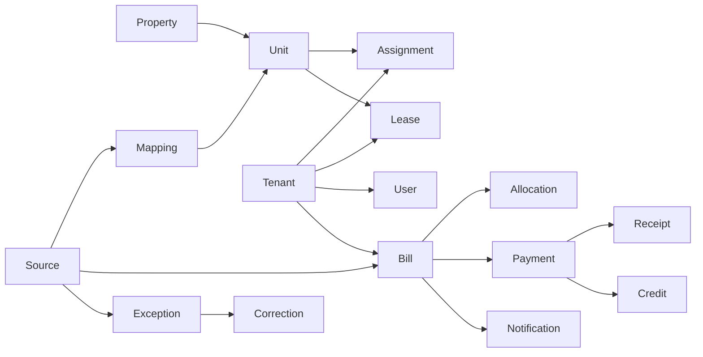

# PropertyPro database and API contract

Version 2.0 · 11 October 2026. The implementation is `server/index.js`, `service.js`, `rules.js`, `integrations.js`, and `store.js`. This is an implemented REST API, not a proposed mock contract.

## Manager-confirmed advance application (12 October 2026 update)

`POST /api/v1/bills/:id/apply-advance` accepts `{ "confirmed": true }` for a Manager. The bill must be the final applicable rent cycle with available confirmed credit and an original confirmed receipt. Reported/Paid bills or excess credit require review. Generation, scheduling and confirmation alone do not apply credit. A fully covered bill becomes Paid with the original receipt/payment; no new payment/receipt is created. A remaining balance stays Unpaid. Retries return the existing settlement. `GET /bills` exposes `availableAdvanceCredit` for eligible final Unpaid records. Application records the Manager and preserves prior values.

## Transport and authentication

### Paged Admin audit history — 16 October 2026

`GET /api/v1/admin/audit?page=1&limit=50&action=payment&from=2026-10-01&to=2026-10-31` requires Admin access. With `page`, it returns `{items,total,page,limit,offset}`. Page size is 1–100; page numbers are positive integers. Requests beyond the final page resolve to the last available page. `action` is a case-insensitive substring filter, and the optional date range includes both calendar dates in Philippine time. Invalid dates, reversed ranges and invalid numeric parameters return the existing 422 validation response. Filtering occurs before paging, with deterministic newest-first ordering. Records are retained in SQLite; a timestamp index supports ordered retrieval.

Without `page`, the endpoint retains its legacy array response and existing maximum of 5,000 returned rows for dashboard/older callers. `scope=maintenance` remains available. This response cap is not a retention limit. The UI's Export action continues to export the complete authorized audit log, not just the displayed page.

### Workspace boundary

Every Manager/Tenant identity includes a server-managed `workspaceId` and a display `workspaceName`. After authentication, the backend scopes the entire request to that membership; body/query workspace IDs cannot select another business. A Tenant login must match the workspace of its permanent Tenant record. System Admin accounts have no property workspace and cannot invoke Manager/Tenant billing routes. Account membership edits revoke existing sessions.

Admin-only workspace routes: `GET /admin/workspaces`, `POST /admin/workspaces` with `{ "name": "Property business" }`, and `PATCH /admin/workspaces/:id` to rename it. Account creation/update accepts `workspaceId` for Manager/Tenant roles; Admin workspace is always null. Workspace settings, mappings, duplicate checks, uploads, exports, documents, receipts and notification recipients are isolated. See [Workspaces](workspaces.md) for migration, private integration configuration and operating limits.

Base path: `/api/v1`. Requests and errors are JSON unless a download is requested. Login uses POST. Every protected endpoint requires `Authorization: Bearer <token>`. No cookie authentication is used. The frontend clears its cached session and returns to login after a protected request returns 401.

Sessions last eight hours, are stored by SHA-256 token hash, and survive server restarts. Plain tokens remain in browser sessionStorage. Passwords use salted scrypt; account password changes invalidate stored sessions. Login throttling is per process, address and email. CORS uses an explicit allowed-origin set; it does not use wildcard credentials. Request bodies are limited to 15 MB and must be JSON objects.

Status codes: 200 success, 400 malformed request, 401 missing/expired/invalid credentials, 403 denied role/ownership/origin, 404 unknown record/endpoint, 409 dependency/history/idempotency conflict, 413 request size, 415 content type, 422 invalid domain input, 429 login throttle, 503 unconfigured integration. Unexpected server errors return a generic message and are logged locally.

```json
{"message":"Access denied","code":null}
```

Admin has system maintenance permissions only. Manager owns business administration and confirmation. Tenant accesses only the linked tenant record. A caller cannot choose a role through the login request.

## Persistent database

SQLite is a central server database in WAL mode with foreign keys enabled and synchronous transactional domain mutations. Entity tables use permanent primary keys, indexed relationship columns and JSON payloads for detailed/versioned records. This is a relational database with flexible payloads, not browser storage. It is designed for a single application server; there is no horizontal write-cluster implementation.

| Table | Relationship / constraint |
| --- | --- |
| properties | Permanent property ID |
| units | FK propertyId; unique unit code enforced by service |
| tenants | FKs unitId, propertyId; permanent tenant ID |
| assignments | FKs tenantId, unitId; current start/end/occupancy |
| leases | FKs tenantId, unitId; original start/end/anniversary |
| users | Unique email (case-insensitive); optional unique tenantId FK |
| sessions | User FK, hashed token, expiry |
| incoming | Original source metadata, hash, raw extraction, normalized fields, rules/outcomes |
| mappings | Unit FK; unique normalized provider/account pair |
| bills | Tenant/property/source FKs; unique cycleKey; lines, status, revision snapshots |
| lines | Bill FK, cascade dependency; synchronized line status |
| allocations | Source/bill/tenant FKs; nonnegative integer cents; frozen recipient list/date |
| payments | Bill/tenant FKs; report/confirmation/rejection history |
| receipts | Unique payment FK; bill/tenant FKs; issued only after confirmation |
| credits | Tenant and original advance-bill FKs; one application reference |
| rent_cycles | Unit FK; persisted lease/group cycle deduplication |
| exceptions | Source/bill FKs; rule, failure and open/revalidated state |
| corrections | Source/bill/Manager FKs; field, old/new values, reason, revision; configuration target when applicable |
| notifications | Tenant FK; unique eventKey; read status and delivery metadata |
| subscriptions | User FK; actual Web Push subscription |
| messages | Tenant FK; permanent recipient and Manager sender identity |
| documents | Tenant FK; protected file metadata |
| audit / activity | Actual operation records and UI feed |
| settings / intake_messages | Stored policy/scheduler state and IMAP UID deduplication |

Lease and assignment rows currently mirror one active tenancy per tenant record. Transfers/renewals with retained multi-lease history under the same identity are not implemented. Existing financial records retain their frozen assignment/allocation context and prevent destructive changes.



## Implemented endpoints

Role `Own` means Tenant ownership or Manager business access, as specified by the endpoint.

| Method and path | Role | Operation |
| --- | --- | --- |
| POST /auth/login | Public | `{email,password}` → `{token,user}` |
| GET /auth/me | Authenticated | Restore server-authorized user |
| POST /auth/logout | Authenticated | Invalidate current token |
| PATCH /auth/profile | Authenticated | Save name/email/phone/preferences or currentPassword + new password |
| GET /dashboard/stats, /dashboard/activity?limit=12 | Manager | Derived counters and actual events |
| GET/POST /properties, /units, /tenants, /mappings | Manager | Lists and validated creates |
| GET/PATCH/DELETE /properties/:id, /units/:id, /mappings/:id | Manager | Read/edit/delete unused records |
| GET /tenants/:id | Own | Tenant detail, own bills/payments/documents |
| PATCH/DELETE /tenants/:id | Manager | Edit/end assignment; protected deletion |
| GET /tenants/:id/bills, /payments, /documents | Own | Scoped related records |
| GET /tenant/unit | Tenant | Assigned unit |
| GET /bills?status=&tenantId=&q= | Own | Scoped bill list |
| GET /bills/:id | Own | Bill detail and lines |
| GET /bills/incoming?status= | Manager | Extracted sources and processing state |
| POST /rent/generate | Manager | Catch up eligible anniversary cycles |
| POST /intake/upload | Manager | `{filename,type,base64}` → extraction and validation |
| POST /intake/sync | Manager | Real configured IMAP sync |
| GET /incoming/:id | Manager | Normalized source and rule results |
| GET /incoming/:id/source | Manager | Protected original bytes |
| POST /incoming/:id/correct | Manager | `{field,value,reason}` → retained correction/revalidation |
| POST /bills/:id/correct-rent | Manager | `{amount,reason}` whole-unit source amount; revise unpaid frozen cycle |
| GET /exceptions?state= | Manager | Review records |
| POST /exceptions/:id/resolve | Manager | Source correction or `{revalidate:true}`; unresolved failures remain open |
| POST /bills/:id/report-payment | Tenant | Full outstanding `{method,reference}` |
| GET /payments?status=&tenantId= | Own | Payment history, including rejected reports |
| POST /payments/:id/confirm | Manager | Idempotent confirmation and unique receipt |
| POST /payments/:id/reject | Manager | `{reason}`; retained rejection and unpaid bill |
| GET /receipts/:id | Own | Escaped HTML receipt |
| POST /documents | Manager | `{tenantId,filename,type,base64}` protected upload |
| GET /documents/:id | Own | Protected file bytes and audit record |
| GET /messages | Tenant/Manager | Own inbox / Manager message records |
| POST /messages | Manager | `{tenantId,subject,body}` persisted portal message |
| GET /notifications | Tenant | Own saved events |
| POST /notifications/read | Tenant | Mark own events read |
| GET /notifications/push-config | Tenant | Public key and configuration flag only |
| POST /notifications/push-subscription | Tenant | Actual browser `{endpoint,keys}`; supported HTTPS push-service allowlist |
| GET/PATCH /settings/profile, /settings/billing-rules | Manager | Policy/mailer-address/delivery settings |
| GET /reports/summary?range=current | Manager | current, 1d, 30d, 365d, all |
| GET /exports/tenants, /exports/reports?range=, /exports/audit | Manager; Admin for audit | CSV with formula escaping |
| GET/POST /admin/users | Admin | Safe account list/create |
| PATCH /admin/users/:id | Admin | Role/status/password maintenance; invalidates sessions |
| GET /admin/audit?limit=50, /admin/services | Admin | Actual audit and observed component state; optional scope=maintenance filters the home summary before applying the limit, without deleting full audit history |
| POST /admin/status (legacy alias /admin/health) | Admin | Lightweight configuration, availability and historical-result snapshot; audit the refresh; no external sends or live OCR. See [criteria](system-status.md). |
| POST /admin/backup, /admin/ocr-restart, /admin/purge | Admin | Database snapshot, worker restart, temp-cache purge |

Manager GET /notifications currently returns an empty list: Manager navigation uses billing/exception counters. Messages use the portal inbox. Supplementary rent emails are sent by the scheduler through SMTP; there is no public email-sending endpoint. SMS and utility email notifications remain excluded.

Rent events store `emailType`, `emailBillId`, and independent email delivery fields in the existing notification record. Only rent billing updates, eligible rent reminders, and Manager-confirmed rent payments are eligible. Tenant profile preferences include `emailRent`; disabling it suppresses SMTP sending. Category preferences (`billing`, `reminder`, `payment`) also apply. Sending never changes payment or receipt records. SMTP acceptance is recorded as `accepted`, not inbox delivery or readership. Unconfigured historical events, stale bill revisions, opted-out recipients, and no-longer-eligible reminders are not sent. A reminder's first submission must occur in the 9:00–9:01 AM Philippine-time window; missed first attempts are skipped. Already-attempted failures may retry on the same scheduled day while still eligible. Submission attempts are bounded to three, spaced at least five minutes apart, with up to twenty submissions per scheduler run. Uncertain in-flight outcomes are retained as `unknown` and are not automatically resent.

### Payload examples

```json
{"name":"Building E","letter":"E","address":"Pasig address","city":"Pasig City","type":"apartment"}
```

```json
{"propertyId":"prp-...","code":"E-101","floor":"Ground Floor","floorNumber":1,"type":"Studio","monthlyRent":"10000.01","arrangement":"individual"}
```

```json
{"fullName":"Example Tenant","email":"tenant@example.test","unitId":"uni-...","leaseStart":"2026-10-11","assignmentStart":"2026-10-11","leaseEnd":null,"assignmentEnd":null,"occupancy":"active"}
```

Account creation additionally needs name, email, role, password and a real tenantId for the Tenant role. Tenant creation does not silently create a login account; account maintenance belongs to Admin.

Correction dates use ISO `YYYY-MM-DD`. Required utility fields are provider, accountRef, amountDue, dueDate, periodStart and periodEnd. V02 accepts nonnegative money and valid ordered period endpoints; it does not impose an extra due-date-versus-period-end rule. Ambiguous/conflicting extraction enters V01 review. The source retains raw text, hash, original file, applied rule identifiers, per-rule validation results and overall processing outcome.

Only `unpaid`, `tenant_reported_paid`, and `paid` are payment statuses. A rejected payment report uses `unpaid` plus rejection metadata. A zero-balance credit-settled bill retains its status and explicit credit information; it is not a fictitious cash confirmation.

Amounts are returned in PHP with at most two decimal places; allocations are computed/stored as integer centavos. `amount` in rent correction is the whole-unit rent for that cycle, not an individual share. Finalized recipient lists remain fixed. Confirmed/report-pending charges cannot be corrected silently.

Manager settings permit an intake address and pushEnabled. Equal splitting, required first advance, non-prorated rent and three-day reminders are fixed paper policy; attempts to enable conflicting options return 422. Credentials and VAPID private keys are configured only on the server through `.env`.

## Integration verification

The tests run an actual HTTP server, authorize all roles, check tenant ownership and private-file denial, create/edit/delete records, finalize MIME/PDF/image sources, revise bills, report/reject/confirm payments, download receipts/documents, create a backup and reopen it. Persistence/session invalidation, integer reconciliation and idempotency are asserted. A real browser verifies connected screens and controls.

Web Push encrypted request construction/retry uses a test transport; it does not prove external delivery. Live IMAP login/retrieval is pending a real account. See [QA report](qa-report.md) and [manual](user-manual.md).

Implementation references: [Node SQLite API](https://nodejs.org/api/sqlite.html), [ImapFlow fetch](https://imapflow.com/docs/guides/fetching-messages/), [web-push](https://github.com/web-push-libs/web-push), [Tesseract.js](https://github.com/naptha/tesseract.js).
