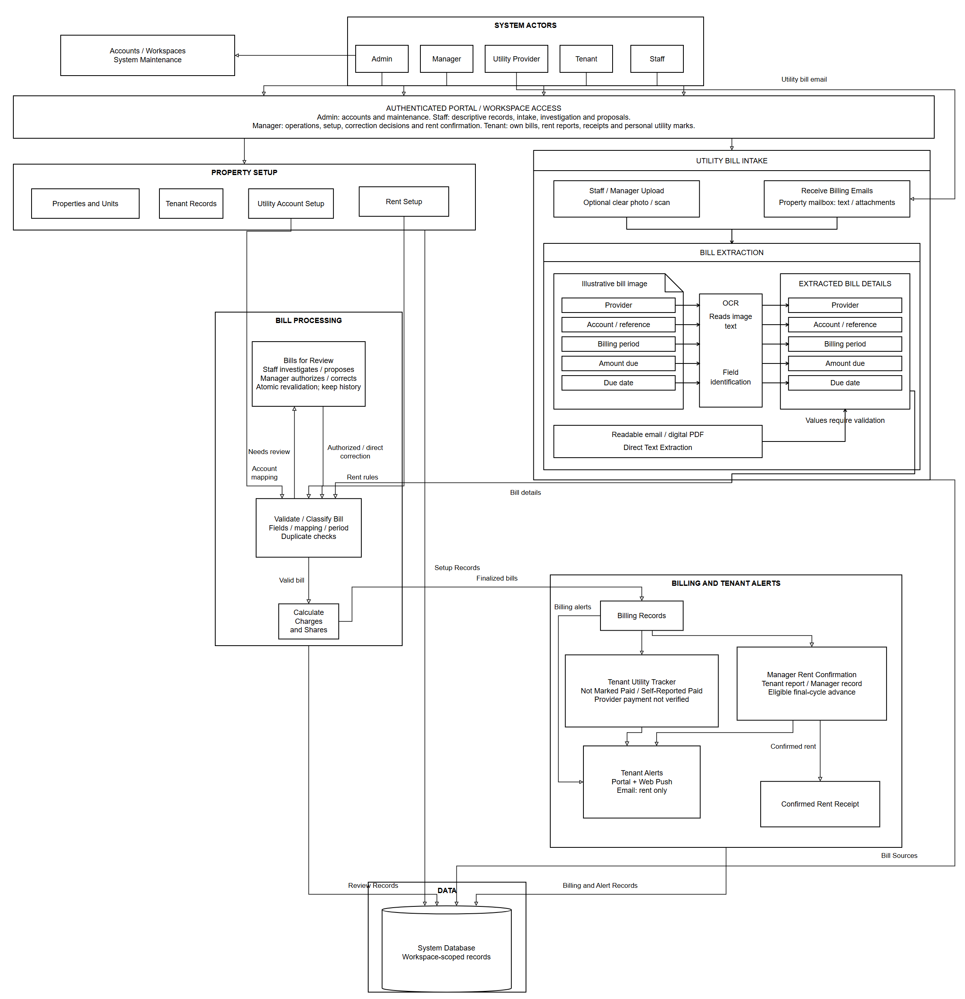
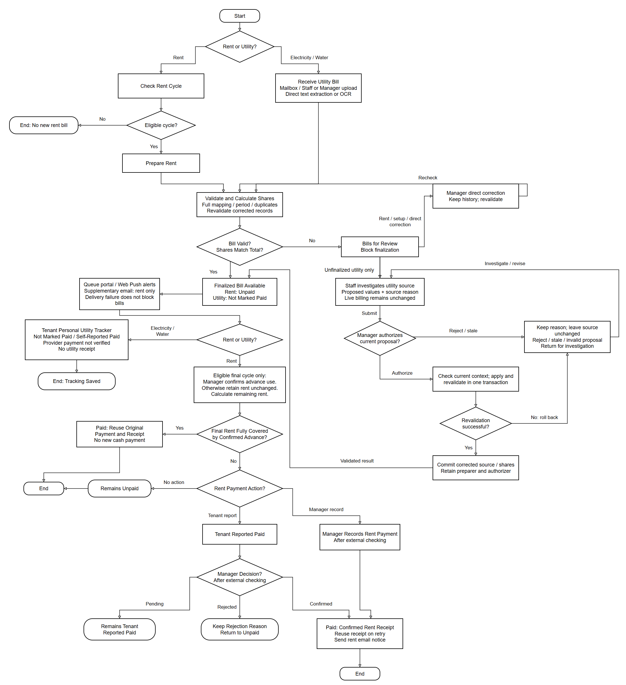
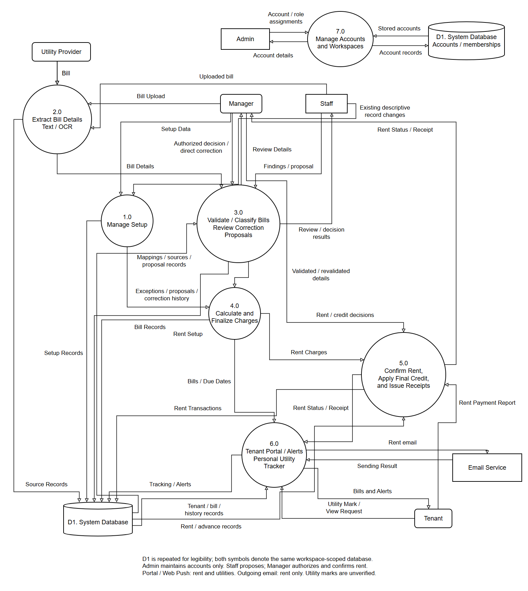

# CHAPTER II

**METHODOLOGY**

This chapter presents the methodology and procedures that will guide the development of the proposed Intelligent Property Management Workflow with OCR-Enabled Automated Billing Classification and Tenant Notification. It describes the project requirements, system design, conceptual operation, interface mockups, and Iterative Software Development Methodology. It also presents the testing and evaluation procedures that will be used to examine the developed system within the approved scope of the study.

## 2.0 Project Overview

### Project Information

The project, entitled Intelligent Property Management Workflow with OCR-Enabled Automated Billing Classification and Tenant Notification, is a web-based system for selected boarding houses and residential apartments in Pasig City. It supports property, unit, tenant, rent, electricity, water, utility-mapping, billing, payment-status, exception, receipt, and applicable notification records. The system provides an integrated workflow for rent and utility billing. It receives supported utility-bill email summaries and attachments through the designated property-management email account and allows optional Staff or Manager uploads of clear photographs or scans of printed provider bills. Readable email and digitally generated PDF text is extracted directly, while clear bill images undergo OCR. Extracted information is validated and processed through predefined rules before billing computation and finalization. The system manages exceptions, records rent payment reports and Manager confirmations, supports approved use of confirmed advance credit, and provides digital receipts for confirmed rent payments. Electricity and water use separate personal tracking marks maintained by the assigned Tenant, without provider payment verification or system-issued utility receipts. Permitted Web Push billing updates and due-date reminders, together with supplementary rent email notifications, direct tenants to the authenticated portal.

In this study, intelligent refers to OCR-enabled document text extraction combined with predefined, explicit, deterministic, and traceable rules. The OCR component may use machine-learning-based text recognition to extract available document information, but it does not make autonomous billing, validation, allocation, payment, or property-management decisions. Readable email and digital-PDF text is also extracted directly before validation. Billing and property-management decisions use defined rules and Manager-controlled actions.

### Requirements Definition

The proposed system is designed to meet the following business, user, and security requirements.

#### A. Business Requirements

The system shall retrieve supported utility-bill email summaries and attachments from the designated property-management mailbox and allow optional Staff or Manager uploads of clear photographs or scans of printed provider bills. Direct text extraction or OCR shall obtain the amount due, due date, billing period, provider, and account or reference identifier according to the source format. Explicit, deterministic, and traceable rules shall check required values, provider/account mappings, periods, and duplicates across all supported intake methods, identify the billing category and individual or shared arrangement, and route unprocessable records to the Exception Queue. Masked or incomplete identifiers shall require Manager review against verified account information rather than inference of hidden characters. Only valid records shall proceed to computation and finalization. Manager corrections shall undergo revalidation and, where applicable, reprocessing or recomputation, including corrections to finalized records.

Billing shall cover rent, electricity, and water. Fixed, non-prorated rent shall be generated once per lease cycle on the anniversary date, using the last calendar day when necessary and retaining the original day for later months. Missed eligible cycles shall be recovered once after server availability resumes, with original due dates and actual creation dates retained. One-month advance rent shall appear separately on the first bill and become available credit after payment confirmation. Only the Manager shall confirm applying available credit to the final applicable rent cycle. Applied amounts shall not be reused, and the system shall not automatically create a replacement advance charge. Shared charges shall be split equally among eligible tenants in the configured group, using the scheduled rent-cycle date for rent and the final day of the source period for utilities. For recovered rent cycles, eligibility shall use the original scheduled date rather than the recovery date. The eligible list shall be stored. Whole-centavo computation and remainder distribution in ascending permanent Tenant-record identifier order shall preserve the source total. Missing groups or eligible tenants shall require exception review. Duplicate billing, repeated advance-rent lines, and repeated credit application shall be prevented. Tenants shall arrange who pays a shared provider bill outside the system; calculating shares shall not establish provider settlement.

The centralized database shall retain property, unit, Tenant, mapping, rent, billing, rent-payment, utility-tracking, exception, correction, receipt, and applicable notification records. Rent bills shall use Unpaid, Tenant Reported Paid, and Paid. Tenant reports shall remain unconfirmed until Manager confirmation; the Manager may also record and confirm an actual rent payment without a prior report after external checking. Receipts shall be issued only for confirmed rent payments. Utilities shall use separate Not Marked Paid and Self-Reported Paid tracking labels, with the notice “Provider payment not verified.” Each utility mark shall belong to the reporting Tenant and the corresponding bill or allocated share, without authorizing a system-issued receipt or changing other tenants' marks. Tenants shall access their bills, stored portal notifications, history, rent statuses, personal utility tracking, and confirmed rent receipts through the authenticated portal. Eligible reminders shall be scheduled at 9 AM Philippine time, three calendar days before the actual due date. Routine valid billing records shall proceed automatically, while exceptions shall require Manager intervention. Web Push shall provide permitted rent and utility alerts. Supplementary email notifications shall cover rent billing updates, eligible rent reminders, and Manager-confirmed rent payment notices only. Outgoing rent email shall be separate from utility-email intake. The system shall use the Tenant's registered email address and retain queued events, channel-specific attempts, and available acceptance or failure results. Limited retries and duplicate controls shall prevent repeated sends during normal processing. Sending failure shall not change payment status or prevent portal access. SMS, GSM, and utility email notifications shall not be used.

#### B. User Requirements

The Admin shall manage authorized login accounts, roles, workspace membership and system maintenance without rent-confirmation authority. The Manager shall establish billing-linked property, unit and Tenant occupancy records, verified utility mappings and rent settings, and retain authority over sensitive billing corrections, rent confirmation and eligible final-cycle advance application. The Manager may also perform Staff operations. Staff shall access only their assigned workspace, update permitted descriptive details on existing records, upload utility bills, monitor email intake, inspect original sources and extraction results, and record investigation notes or escalations. Staff shall not directly change billing amounts, due dates, periods, mappings, allocation membership, rent settings, occupancy dates or login credentials of other users. Staff may prepare a single pending correction proposal containing the necessary changes and a reason for an unfinalized incoming utility bill. Manager authorization shall check current authority, proposal freshness and applicable validation rules before atomic application; rejection, stale data or failed validation shall leave proposed billing changes unapplied and retain the handling reason. Manager direct corrections shall use existing safeguards and preserve history without requiring another Manager signature. Finalized billing corrections shall remain Manager-controlled, and no authorization shall override duplicate protection. Valid bills shall proceed automatically without routine human approval.

Tenants shall view their own assigned unit, bills, history, permitted portal notifications, confirmed rent receipts and personal utility tracker. Tenants may report rent payment for Manager confirmation, while the Manager may directly record and confirm an externally checked rent payment without a prior report. Rent statuses shall remain Unpaid, Tenant Reported Paid and Paid. Utilities shall retain Not Marked Paid and Self-Reported Paid with the notice "Provider payment not verified." Only the assigned Tenant shall change a personal utility mark; Staff and Manager shall not verify provider settlement or issue utility receipts. Permitted Web Push and supplementary rent email notifications shall direct Tenants to the authenticated portal. Staff may view workspace rent statuses and existing confirmed receipts for operational support without creating or altering them; financial summary reports shall remain Manager-only.

#### C. Security Requirements

The system shall require valid credentials, restrict functions and records according to the Admin, Staff, Manager and Tenant roles, and limit property, tenant, utility, billing, payment, exception, correction, receipt, notification and source-document access to authorized users and functions. Authentication, defined permissions and session management shall protect records from unauthorized access or modification. User-provided and extracted information shall be validated before storage or processing; failed field, identification, mapping, duplicate or other required checks shall route records to the Exception Queue. Correction information shall be retained in the centralized database. Outgoing email shall use authorized Tenant recipient records and TLS-protected submission to the configured mail service. Sending credentials shall remain in protected backend configuration and shall not be exposed to browser code, notification content, or exports. Messages shall contain limited alert information and direct tenants to authenticated records; an email link shall not bypass access restrictions. These requirements cover the implemented controls and evaluation criteria and do not constitute legal certification or a complete privacy audit.

## 2.1 Concept of the Study

### Architectural Framework

The framework connects property and unit records, tenant records, utility-account mappings, and rent settings with utility intake, text extraction or OCR, validation, classification, and billing computation. It also includes exception handling, rent confirmation, advance-credit application, confirmed rent receipts, personal utility tracking, and permitted notifications. These functions use one centralized database. Admin maintains accounts and authorized workspace assignments. Staff handles permitted daily operations and investigates exceptions, while the Manager controls financial settings and decisions. Tenants access their own records, and utility providers supply billing information through supported sources.

*Figure 2.1: Architectural Framework*

Property and Unit Management manages property and unit information. Tenant Management manages Tenant information and its association with the applicable property or unit. Utility Provider and Account/Reference Mapping stores the provider, account or billing number, covered property or unit, and Manager-selected Individual or Shared-Occupancy Billing Arrangement. Individual utility bills follow the assigned account without splitting. Shared bills are divided equally among eligible tenants in the configured group. Tenants decide which person pays the whole shared provider bill outside the system; the allocation does not represent collection or verified payment.

Rent will be generated once per monthly lease cycle on the configured anniversary date, which will also be its due date. The charge will be fixed and non-prorated, with its coverage period recorded. If the anniversary day is absent, the system will use the month's last day and retain the original day for later months; a January 31 anniversary therefore uses February 28 or 29 and then March 31. If the server is unavailable, missed eligible cycles will be recovered once when processing resumes. Each recovered bill will retain its original due date, coverage period, and scheduled eligibility date while recording its actual creation date. Generation checks will prevent duplicate cycles, repeated advance-rent lines, and new cycles after the lease end date. Existing unpaid charges will remain accessible, and later membership changes will not silently replace finalized bills. Rental records will use a start date and an optional end date for month-to-month occupancy. A blank end date will mean that the rental continues; it will not require a separate renewal transaction. When the Manager records the Tenant's departure date, rent generation will stop for cycles scheduled after that date. Previous charges and their associated tracking, payments, and receipts will be retained. The study will not include automatic transfers between units or automatic lease-renewal processing.

The first bill will show current rent and one-month advance rent as separate rent lines. Advance rent is not a security deposit and will become available credit only after Manager confirmation of its payment. Shared tenants will have separate current-rent and advance-rent shares. Available advance credit will be reserved for the final applicable rent cycle and applied only after Manager confirmation. The system will display the final-cycle charge, confirmed available credit, and remaining balance before application. If the approved credit fully covers the charge, the bill will become Paid using the original confirmed payment and receipt reference, without another cash payment or duplicate receipt. Applied credit shall not exceed the available confirmed amount and shall not be reused. Fully consumed credit will no longer be available for another charge, and no replacement advance charge will be generated automatically. Only a remaining outstanding balance may be reported for payment. Credit shall not be applied to a bill already marked Paid; a pending rent report shall require Manager review before application. A mismatch between available credit and the final-cycle charge will require Manager review rather than an invented refund or automatic settlement.

The designated property-management mailbox will retrieve supported utility-bill email summaries and attachments. Staff or the Manager may also upload a clear photograph or scan of a printed provider bill. All supported sources will follow the same validation, mapping, and duplicate-checking workflow. Readable email summaries and digitally generated PDF text will be extracted directly, while an existing OCR engine will recognize text from clear images of selected provider layouts without researcher training or customization of a machine-learning model. Predefined extraction rules will obtain the amount due, due date, billing period, provider, and account or reference identifier while retaining the source reference. Text extraction and OCR will not establish payment status, billing validity, or Tenant charges; extracted fields will undergo validation and mapping. Actual validated utility due dates will be used for billing and reminders, without predicting dates for documents not yet received. The system will not automatically access provider apps or read phone notifications. A separately configured outgoing email function will send supplementary rent alerts; it will not depend on retrieving a utility-provider email.

Absent, unreadable or conflicting values, and unsupported attachments, will require exception review rather than finalized charges. Supported email formats, document layouts, file types and processing limits will be documented before final testing. Evaluation will compare extracted fields with manually checked samples and report results only within the declared email and document boundaries. If a provider sends only a notification link or insufficient billing information, the record will require Manager review and an available supported source; a complete PDF attachment or unmasked account identifier will not be assumed.

Validation will check required fields, currency amounts, valid dates and a billing period whose beginning does not follow its end. Account identifiers will remain text to preserve leading zeros. A unique Manager-configured provider/account mapping will identify electricity or water and the covered property or unit; its saved configuration will determine the billing arrangement. Provider aliases will follow an explicit list. Missing, conflicting, invalid or unmappable values will enter the Exception Queue rather than being guessed. Masked or incomplete identifiers will remain unresolved until Manager review establishes the correct registered account. The system will not guess hidden characters. Rent will follow saved configuration without OCR classification.

Duplicate checks will compare source copies and provider/account/period combinations across email summaries, attachments, and uploads with existing records. Repeated or revised bills will require Manager review before another charge or correction is accepted, and reprocessing an accepted source will not create duplicate allocations. Each result will retain its source reference, normalized fields and applied rule identifiers. Corrected records must pass the same checks before computation and finalization.

**Table 2.1: Validation and classification rules**

| Rule ID | Rule Name | Description | Action/Result |
| --- | --- | --- | --- |
| V01 | Required information | Amount, due date, billing period, provider, or account identifier is missing, masked, incomplete, or conflicting | Exception Queue; no finalization |
| V02 | Valid values | Amount or date cannot be interpreted, amount is negative, or period begins after it ends | Exception Queue; Manager review |
| V03 | Unique mapping | Provider/account identifies exactly one configured target and category | Continue; otherwise Exception Queue |
| V04 | Duplicate check | Identical source copy or the same provider/account/period is already recorded across supported intake methods | Hold for duplicate or revised-bill review |
| C01 | Utility category | Configured provider/account mapping identifies electricity or water | Assign mapped category |
| C02 | Billing arrangement | Target has a valid individual/shared configuration | Apply saved arrangement; otherwise Exception Queue |
| A01 | Allocation | Eligible group and reconciled shares are available | Proceed to finalization; otherwise Exception Queue |
| R01 | Rent cycle | Lease/cycle already has a rent charge | Do not generate a second charge |

Individual charges will follow the configured lease or utility account. Shared rent and utility charges will be split equally among eligible tenants in the Manager-configured property or unit group, without consumption estimates or meter readings. Eligibility will use active assignments on the scheduled rent-cycle date for rent and on the source period's final day for utilities, excluding assignments already ended. Recovered rent cycles will use their original scheduled eligibility dates. The system will retain the eligible list so later occupancy changes do not alter finalized charges. Missing groups, periods, or eligible tenants will enter the Exception Queue. Computation will divide the source charge in whole centavos, assigning equal base shares and distributing leftover centavos in ascending permanent Tenant-record identifier order. PHP 100.00 split among three tenants will produce PHP 33.34, PHP 33.33, and PHP 33.33. Shares will display two decimal places and must total the source charge before finalization. For shared utilities, tenants will arrange one person to pay the whole provider bill outside the system. Personal tracking will refer only to each Tenant's allocated share and will not establish payment of the full provider account.

The Exception Queue will block finalization until the applicable Manager decision and successful validation. Staff may investigate, add notes and propose corrections to unfinalized sources without changing live billing. Manager authorization will check current access and billing context, apply all proposed fields together and rerun validation. Rejected, stale or invalid proposals will retain reasons and leave the proposed billing change unapplied. Managers may also correct directly. Corrections will retain previous and new values, reason, preparer and authorizer where applicable. Unresolved records will remain blocked; submitting a correction alone will not establish validity.

Billing Records will retain rent and utility charges while separating rent confirmation from personal utility tracking. Rent will use Unpaid, Tenant Reported Paid, and Paid. Tenants may report full payment of a selected outstanding rent balance; partial payments and overpayments will not be processed automatically. Only one pending rent report shall be retained per bill, and repeated submissions shall not create another report. Tenant reports will remain pending until the Manager checks the payment outside the system. Rejection will record a reason, restore Unpaid, and preserve report history. The Manager may also record and confirm an actual rent payment without a prior Tenant report after external checking. Either confirmation path will retain the confirmed amount, payment date, Manager identity, and unique receipt. Repeated submission or confirmation of the same transaction will not create another payment or receipt.

Electricity and water will use the personal tracking labels Not Marked Paid and Self-Reported Paid, accompanied by “Provider payment not verified.” Tenants may change only their own bill or allocated-share mark, with dated history retained. In shared arrangements, tenants will decide which person pays the provider bill; a personal mark will not change other tenants' marks or establish settlement of the entire account. Utility tracking will require neither Manager confirmation nor a system-issued receipt. A mark will refer to the recorded bill or allocation version, so later charge corrections will preserve earlier history and require Tenant review of the revised information. The system will not independently verify cash, bank transfers, electronic-wallet transactions, Tenant contributions, or utility-provider payments.

Finalized corrections will preserve prior values and processing history. Unpaid rent charges may be corrected after revalidation and recomputation; pending reports must be reviewed against revised amounts. Paid rent bills will retain their original payment and receipt, with corrections recorded as linked revisions showing charge and balance changes. Utility corrections will retain their original source, allocation, and associated personal tracking history and undergo applicable validation and recomputation. External payments or refunds will remain outside automated settlement. Tenants will access current and historical records through the authenticated portal.

The Centralized Database will relate properties, units, tenants, leases, utility mappings, billing sources, allocations, rent payment reports, Manager-recorded payments and confirmations, confirmed rent receipts, advance-credit applications, utility tracking history, exceptions, corrections, and notifications. Recorded assignments will support multiple tenants per shared unit. Allocations will link to their source and eligible group; rent payments and receipts will link to their bills. Personal utility tracking will link to the assigned Tenant and the relevant bill or allocated share. Notification records will link billing events to recipients and applicable channels, retaining schedules, attempts, and available sending results. These relationships will preserve transaction history and support access restrictions. Corrections will remain centralized records rather than a separate architectural component. The database design will define storage relationships while the framework, flowchart, and DFD describe structure and operation.

Web Push will provide external alerts for rent and utility records, while supplementary email will be limited to rent billing updates, eligible rent reminders, and Manager-confirmed rent payment notices. On a supported browser, Tenant permission will allow creation and storage of an account/device subscription and the background handling needed to receive a Web Push alert. Rent email will use the Tenant's registered email address and a configured SMTP service through a TLS-protected connection. Alerts will direct tenants to authenticated records without revealing complete billing details beforehand or changing payment status. Finalization and relevant corrections will trigger billing updates. A confirmed rent payment notice will refer to the existing confirmed transaction and receipt rather than create another payment or receipt.

Reminders will be scheduled at 9 AM Philippine time, three calendar days before the actual due date, for eligible Unpaid rent and utility records Not Marked Paid. Rent reminders will use the applicable Web Push and email channels; utility reminders will use Web Push only. Rent reports awaiting Manager confirmation and utility records marked Self-Reported Paid will be excluded. A utility reminder will prompt the Tenant to check whether the bill or share has been paid; suppressing it after a personal mark will not establish provider settlement. Corrected due dates will replace pending schedules, and repeated events will not duplicate reminders. Bills unavailable before the scheduled reminder time, including same-day rent and late recovered bills, will receive billing updates rather than backdated reminders. If the server misses the reminder time, it will not send a retrospective reminder for that missed event.

Portal notifications will retain alerts for tenants to view after login, regardless of external delivery. Notification records will distinguish scheduling, attempts, and available push-service or email-server acceptance and failure results for each channel. One billing event will link to its applicable channel records, with limited retries and duplicate prevention. An accepted message will not prove device delivery, inbox delivery, or readership. Email sending will require internet connectivity, protected sending credentials, and a running backend. Invalid subscriptions, denied permission, unsupported devices, unavailable email configuration, and sending failures will not prevent authenticated access to bills, rent statuses, personal utility tracking, or confirmed rent receipts. Tenant SMS, GSM, and utility email notifications will remain excluded.

The Admin performs account and system maintenance. The Manager controls billing setup, verified mappings, sensitive corrections, rent confirmation and eligible advance application while retaining operational access. Staff performs permitted descriptive updates, bill intake monitoring, source inspection, investigation and correction preparation in the assigned workspace. The shared Exception Queue retains responsibility, notes and proposal decisions on related records; it does not duplicate bills between Staff and Manager queues. Valid bills continue automatically. The Tenant views own records, reports rent and maintains personal utility tracking. The Utility Provider supplies supported electronic summaries or documents through the designated property-management mailbox, or printed bills submitted as clear images by Staff or Manager. Provider settlement and shared-bill contribution collection remain outside independent system verification.

The components form one web-based workflow. Saved property, Tenant, mapping, and rent information supports utility intake, direct text extraction, OCR, validation, allocation, and exception handling. Rent payment confirmation, final-cycle advance credit, confirmed rent receipts, and personal utility tracking remain separate functions. The Centralized Database retains their records, while Web Push provides permitted rent and utility alerts and email provides supplementary rent alerts. Each actor uses only the functions assigned to their role.

## 2.2 Conceptual Operation

The workflow uses property, Tenant, utility-mapping, and rent configuration to process rent, electricity, and water charges. Monthly rent follows the fixed anniversary rule, with one-month advance rent shown separately on the first bill. Missed eligible cycles are recovered once with original due dates and actual creation dates retained. Utility processing receives supported property-email summaries and attachments or Staff- or Manager-uploaded clear images of printed bills. Readable email and digital-PDF text is extracted directly; clear images undergo OCR. Required information, mappings, periods, and duplicates are validated, while masked or incomplete identifiers require Manager review against verified account information. Valid records proceed to classification, computation, and finalization; Staff may investigate exceptions and submit proposals; Manager authorization or direct correction and renewed validation are required before blocked bills proceed.

Shared charges use equal splitting among configured eligible tenants, using the scheduled rent-cycle date or the utility period's final day. Whole-centavo computation and consistent remainder distribution preserve the source total. Rent begins as Unpaid; Tenant reports become Tenant Reported Paid until Manager confirmation, while rejected reports return to Unpaid with recorded reasons. The Manager may also record and confirm externally checked rent payments without a Tenant report. Confirmed advance credit may cover the final applicable rent bill with Manager-confirmed application, reusing the original payment and receipt rather than recording another cash transaction. Consumed credit cannot be reused, and no replacement advance is charged automatically. Utilities use separate Tenant-controlled Not Marked Paid and Self-Reported Paid marks with “Provider payment not verified.” Tenants arrange the payer of a shared provider bill outside the system; individual marks do not confirm payment of the full account or authorize receipts. Web Push provides rent and utility billing updates and eligible reminders, while supplementary email provides rent billing updates, eligible reminders, and Manager-confirmed rent payment notices. Reminders at 9 AM Philippine time, three calendar days before the actual due date, follow the defined unpaid-status, pending-report, personal-mark, and bill-availability rules. Rent generated on its due date receives a billing update rather than a backdated reminder. Both channels link to the authenticated portal without proving payment, delivery, or reading.

### Process Flowchart

*Figure 2.2. Overall Process Flowchart*

The flowchart shows rent and utility intake, validation, allocation and finalization. Staff investigates failed incoming utility records and may prepare a correction proposal. Manager authorization checks freshness and reruns validation atomically; rejected, stale or invalid proposals return for review without applying their proposed billing change. Manager direct correction remains available with retained history. Rent continues through Tenant reporting or direct Manager recording, confirmation, and confirmed rent receipts; final-cycle advance credit reuses the original transaction references. Utilities continue through separate personal tracking without Manager payment confirmation or system-issued receipts. Web Push supports both billing paths through permitted alerts, while supplementary email applies to rent only. Sending outcomes do not change billing or payment status.

### Full-Blown Data Flow Diagram

*Figure 2.3. Data Flow Diagram*

The DFD illustrates how billing-related information moves among Admin, Staff, Manager, Tenant, Utility Provider, system processes and Centralized Database. Supporting process 7.0 handles Admin account and workspace maintenance separately from operational billing authority. The repeated D1 symbols represent the same logical database and do not introduce separate databases. Staff supplies permitted descriptive updates, uploads, investigation notes and correction proposals. The Manager supplies authorized correction decisions and financial/setup instructions; related decision details and exception records return to the authorized users. It shows the flow of configuration data, utility-bill information, billing records, payment information, receipt information, and tenant notification information through the system processes. The outgoing email service will receive permitted rent alert information from the notification process, and available sending results will return to the system for recording. Utility-email intake and outgoing rent alerts will remain separate data flows. External entities interact with the system through the appropriate processes, while the Centralized Database stores and provides the records required by the system.

## 2.3 Mockup Design

The mockups present the Admin, Staff, Manager and Tenant interfaces through one sign-in form with access determined after authentication. Shared operational pages expose role-permitted actions rather than separate application copies. Staff views emphasize intake and investigation; Manager views emphasize decisions while preserving operational access; Admin views cover account search, business membership and maintenance. Tenant views retain rent first, the personal utility tracker below rent, bill history, confirmed rent receipts and permitted notifications. Correction views show original and proposed values, evidence, preparer, decision and handling reasons. These designs guide development and do not establish improved usability or completed evaluation results.

## 2.4 Methodology of the Study

The study will use the Iterative Software Development Methodology to develop the proposed Intelligent Property Management Workflow with OCR-Enabled Automated Billing Classification and Tenant Notification. This methodology will organize development into successive iterations in which related system functions will be planned, designed, developed, reviewed, refined, and integrated.

The methodology is appropriate because the system can be developed in related groups of functions and checked as each group is added. These groups cover configuration, utility intake and extraction, validation, billing, payment records, tenant access, and notifications. Valid records will proceed automatically, while exceptions will require the appropriate user action.

### 2.4.1 Principles of the Iterative Methodology

The Iterative Software Development Methodology will be guided by four development principles and the system’s exception-based workflow. First, incremental development will allow the researchers to develop related system functions in smaller iterations instead of implementing the entire system at once. Second, continuous testing and review will allow each iteration to be checked against the defined requirements, user roles, workflow rules, and data requirements.

Third, refinement between iterations will allow issues identified during development to be corrected before related functions are integrated into succeeding iterations. Fourth, cumulative integration will allow functions developed in earlier iterations to work with functions developed later until they form a complete system.

Throughout the iterations, development and testing will preserve the system’s exception-based workflow, allowing valid records to proceed while records requiring review enter the Exception Queue for Manager intervention.

### 2.4.2 Development Iterations of the Methodology

The proposed system will be developed through seven planned iterations based on the functional requirements of the study. Each iteration will focus on a related group of functions that will later be integrated into the complete system.

**Table 2.2: Development Iterations of the Proposed System**

| Iteration | Development Focus | Main Functions |
| --- | --- | --- |
| Iteration 1 | Requirements and System Foundation | User roles, authentication, property, unit, tenant, and Centralized Database structure |
| Iteration 2 | Property and Billing Configuration | Utility providers, account or reference mapping, rent configuration, billing arrangements, and billing rules |
| Iteration 3 | Property-Management Email Intake, Bill Upload, Text Extraction, and OCR | Designated email intake, supported email-summary parsing, attachment retrieval, optional Staff or Manager upload of clear printed-bill images, supported digital-PDF text extraction, and image OCR |
| Iteration 4 | Rule-Based Validation and Exception Handling | Required-field checking, mapping, billing-period checking, duplicate checking, billing classification, Exception Queue, Manager correction, and revalidation |
| Iteration 5 | Billing Computation and Finalization | Rent, electricity, and water billing; Individual and Shared-Occupancy Billing Arrangements; allocation; computation; and Billing Finalization |
| Iteration 6 | Rent Payment, Utility Tracking, Digital Receipt, and Tenant Notifications | Rent statuses, Tenant rent reporting, Manager-recorded payments and confirmation, final-cycle advance-credit application, confirmed rent receipts, personal utility tracking, Tenant portal access and stored notifications, Web Push alerts, and supplementary rent email notifications |
| Iteration 7 | System Integration and Testing | Integration of system functions, implemented security controls, system-wide testing, and final evaluation |

### 2.4.3 Application of the Methodology to the Study

The iterations will begin with system foundation and configuration, followed by utility intake, extraction, validation, and billing. Later iterations will add payment records, tenant access, receipts, and permitted notifications. Each iteration will build on the functions completed earlier.

During development, each iteration will undergo planning, design, development, testing and review, followed by refinement and integration. Findings from testing and review will be used to correct related functions before succeeding components are integrated. Records requiring Manager intervention will be handled through the Exception Queue according to the defined processing rules.

The final iteration will integrate the developed functions and conduct system-wide testing and evaluation. The completed system will be evaluated using the selected ISO/IEC 25010:2023 quality characteristics: Functional Suitability, Performance Efficiency, Interaction Capability, Reliability, and Security. This chapter describes the planned methodology. Recorded development activities and testing results are presented separately in Chapter III; formal evaluation is reported only when completed.

This approach will organize related functions into manageable development cycles. Repeated testing and review will help identify defects and maintain consistency among requirements, roles, workflows, and data structures. Gradual integration will connect these functions while preserving the intended automate-by-default, intervene-by-exception approach.

### 2.4.4 System Testing and Evaluation Procedures

Testing will occur during each iteration and after integration, using business, user and security requirements. Cases will cover normal transactions, incomplete fields, unmapped or masked accounts, duplicates and corrected exceptions, recording inputs, expected and observed results, and pass or failure. Defects will be corrected and affected tests repeated before final evaluation. Email parsing, digital-PDF extraction, and image OCR results for the five target fields will be compared with manually checked sources. Results will be reported separately by extraction method so successful text parsing is not treated as evidence of image OCR accuracy. Field accuracy will equal correctly extracted values divided by expected values, multiplied by one hundred; missing and incorrect values will be recorded. Declared normalization rules must preserve meaning. Email and document sets and rules will be fixed before final testing, with refinement samples identified separately from final evaluation samples.

Validation, mapping, classification, and exception routing will be checked against predefined outcomes for supported email-body summaries, email attachments, and Staff- or Manager-uploaded printed-bill images. Tests will check that missing or masked identifiers remain unresolved until Manager review and that repeated sources across intake methods do not create another charge. Rent and utility computations will be checked independently, including individual shares, exact source reconciliation, anniversary dates, short-month handling, and missed-cycle recovery without duplicate charges. Rent payment tests will verify Tenant reporting, direct Manager recording after external checking, Manager-only confirmation, approved advance-credit use, remaining-balance reporting, and original-receipt reuse without repeated credit or automatic replacement charges. Utility tracking tests will verify that only the assigned Tenant may change their own mark, dated history is retained, and no mark establishes provider settlement or generates a system-issued utility receipt. Reminder tests will check the 9 AM Philippine-time cutoff, three-calendar-day timing, late bills, pending rent reports, and self-reported utility marks. Repeated processing will be checked for duplicate charges, payments, credit applications, receipts, or reminders. Notification tests will check the correct rent recipient and event, rent-only email scope, authenticated portal links, separate channel records, sending failures, limited retries, and duplicate prevention. Controlled real email sending will be distinguished from simulated transport tests; neither email-server nor push-service acceptance will be treated as proof of readership.

Functional Suitability will use requirement tests; Performance Efficiency will use processing and response measurements under a stated environment; Interaction Capability will use representative tasks and an adviser-reviewed questionnaire; Reliability will use repeated-processing, notification retry, and recovery tests; and Security will use authentication, role, unauthorized-record-access, email-recipient, and sending-credential protection tests. User ratings will supplement rather than replace technical evidence.

Staff will upload bills, investigate exceptions and submit correction proposals. Managers will review escalations, authorize or reject proposals, make permitted direct corrections, record or confirm rent payments, and apply eligible final-cycle credit. Tenants will view bills and history, report outstanding rent, use personal utility tracking, access confirmed rent receipts, and follow permitted notification links to the authenticated portal. Controlled rent email receipt and link access will be checked separately from backend sending results. Task completion and difficulties will be recorded. Questionnaire responses will use the approved scale and scoring procedure, while technical results will use counts, percentages, time summaries, and failed-case descriptions. Evaluator selection and counts, document counts, and questionnaire scoring will be settled with the adviser before final data collection. This section specifies the evaluation procedure rather than its results. Chapter III distinguishes the completed development checks from the formal evaluation activities that remain pending.

Role tests will verify Staff read/write boundaries across direct API calls and interface actions, one pending proposal per source, stale-context and preparer-access changes, rejected or invalid corrections, repeated decision attempts and retained history. A Manager decision shall not bypass the original validation and financial-history safeguards. Account, bill and source access shall be tested across workspaces, with authorized Admin maintenance access distinguished from operational billing authority. Synthetic fixtures, actual-provider samples, automated checks and real-device results shall be reported separately.
